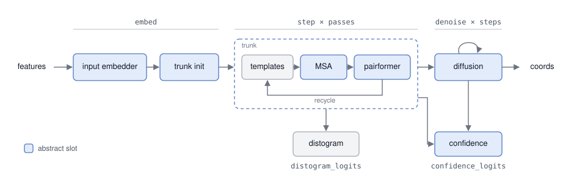

# Models

| | Boltz-2 | ProMERA | Protenix | Mol-1 | OpenDDE | OpenFold3 | ESMFold2 | BioEmu2 |
|---|---|---|---|---|---|---|---|---|
| input embedder | InputEmbedder | PromeraInputEmbedder | InputEmbedder | InputEmbedder | InputEmbedder | InputEmbedder | InputEmbedder | InputEmbedder |
| trunk init | TrunkInit | TrunkInit | TrunkInit | TrunkInit | TrunkInit | TrunkInit | TrunkInit (+ language model) | ConditionedTrunkInit |
| trunk | Trunk | Trunk | Trunk | Trunk | Trunk | Trunk | ParcaeTrunk | ConditionedTrunk |
| templates | 2 layers | — | 2 layers | 2 layers | 2 layers | 2 layers | — | — |
| MSA | 4 layers, residual | 4 layers, residual | 4 layers | 4 layers | 4 layers | 4 layers | 4 layers | 4 layers |
| MSA rows / pass | 1024 | 1024 | 1024, random depth | 1024, random depth | 1280 | 1024 | 1024, query kept | all |
| pair stack | 64 Pairformer | 48 Pairformer | 48 Pairformer | 8 PairMixer + 40 Pairformer | 48 Pairformer | 48 Pairformer | 48 PairMixer | 48 PairMixer |
| diffusion | 24 layers | 24 layers | 24 layers | 24 layers | 24 layers, on structural tokens + 4 Pairformer refiner | 24 layers | 12 layers | dual-stream: 16 token + 16 atom layers |
| confidence | 8 Pairformer, per-token pLDDT | 4 Pairformer, per-token pLDDT | 4 Pairformer, per-atom pLDDT | 4 Pairformer, per-atom pLDDT | 4 Pairformer, per-atom pLDDT | 4 Pairformer, per-atom pLDDT | 4 PairMixer, per-atom pLDDT | — |
| other | confidence pair inputs | — | — | — | — | — | LM encoder (4 PairMixer), Parcae recurrence, coda (2 PairMixer) | unconditional branch |

Generated by `tools/model_table.py` from `escalante-bio/jfold`.
